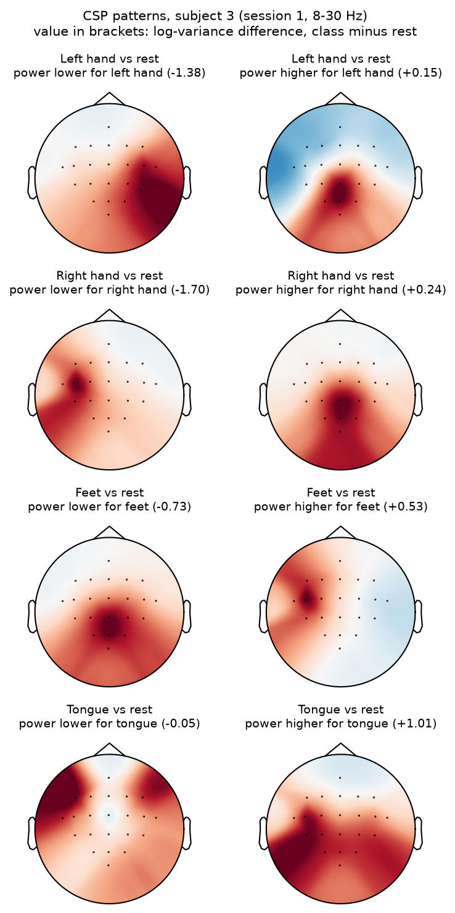
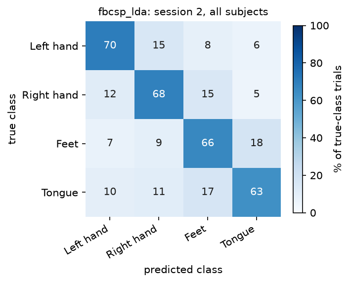

# EEG Motor Imagery Decoding

Decoding imagined movements (left hand, right hand, feet, tongue) from 22-channel
EEG, comparing a classical CSP + LDA baseline, EEGNet and a convolutional-recurrent
model on BCI Competition IV dataset 2a.

> **Status: work in progress.** Phase 1 (setup + exploratory analysis) and
> Phase 2 (classical baselines) are done; EEGNet and the recurrent model come
> next. Every number in this README are saved under `results/`.

## Protocol

- **Data:** BCI Competition IV 2a (MOABB `BNCI2014_001`), 9 subjects, 2 sessions
  of 288 trials each, 4 balanced classes.
- **Evaluation:** within-subject, train on session 1 (`0train`), test on
  session 2 (`1test`), as in the competition. Metrics: accuracy and Cohen's kappa
  per subject, mean ± std across subjects, confusion matrices.
- **No leakage:** normalization statistics, early stopping and hyper-parameters
  use only session 1 (with a stratified 20% validation split); session 2 is used
  once, for the final evaluation. The exploratory analysis also uses session 1 only.

## Setup

Python 3.11.

```bash
python -m venv .venv
# Windows: .venv\Scripts\activate    Linux/macOS: source .venv/bin/activate
pip install torch==2.15.0 --index-url https://download.pytorch.org/whl/cpu
pip install -r requirements.txt
```

Download the data (~750 MB, stored by MNE in `~/mne_data`) and write a trial-count
summary to `results/data_summary.csv`:

```bash
python -m src.data
```

Run the tests (`-m "not data"` skips the ones that need the dataset):

```bash
pytest
```

## Exploratory analysis

[`notebooks/01_eda.ipynb`](notebooks/01_eda.ipynb): raw signals, PSD per class,
ERD/ERS time-frequency maps at C3/Cz/C4, mu-band topographies and per-subject
lateralization. Re-run it with:

```bash
jupyter nbconvert --to notebook --execute --inplace notebooks/01_eda.ipynb
```

## Classical baselines: CSP + LDA and Filter Bank CSP

**Method.** Common Spatial Patterns learns spatial filters (weighted sums of
the 22 channels) whose output variance differs as much as possible between
classes; the log-variance of the filtered signals is the feature vector, and a
shrinkage LDA classifies it. CSP is a two-class method, so the main pipeline
uses one-vs-rest CSP (one binary CSP per class, as in Ang et al., 2012); MNE's
native multiclass CSP (joint approximate diagonalization) is run as an
ablation. Filter Bank CSP fits a one-vs-rest CSP in each of nine 4 Hz bands
from 4 to 40 Hz and keeps the most informative features (mutual information).

| | CSP + LDA | FBCSP + LDA |
|---|---|---|
| Band | 8-30 Hz | 9 bands, 4-40 Hz |
| Window | 0.5-2.5 s after cue | 0.5-2.5 s after cue |
| Covariance | Ledoit-Wolf shrinkage | Ledoit-Wolf shrinkage |
| Tuned on session 1 (5-fold CV) | CSP components | CSP components, number of selected features |

**Results** (session 2, mean ± std over 9 subjects; per-subject values in
`results/<model>/per_subject.csv`):

| Model | Accuracy | Kappa | Session-1 CV accuracy |
|---|---|---|---|
| CSP + LDA (one-vs-rest) | 0.653 ± 0.186 | 0.538 ± 0.248 | 0.691 |
| CSP + LDA (joint multiclass) | 0.641 ± 0.177 | 0.522 ± 0.236 | 0.671 |
| FBCSP + LDA | 0.670 ± 0.169 | 0.560 ± 0.225 | 0.740 |

Kappa per subject:

| Subject | CSP + LDA (OvR) | CSP + LDA (joint) | FBCSP + LDA |
|---|---|---|---|
| S1 | 0.681 | 0.722 | 0.690 |
| S2 | 0.218 | 0.222 | 0.259 |
| S3 | 0.732 | 0.685 | 0.819 |
| S4 | 0.593 | 0.403 | 0.403 |
| S5 | 0.157 | 0.208 | 0.370 |
| S6 | 0.278 | 0.287 | 0.292 |
| S7 | 0.741 | 0.718 | 0.782 |
| S8 | 0.787 | 0.708 | 0.755 |
| S9 | 0.653 | 0.741 | 0.667 |

Every subject is above the chance level (accuracy 0.292, the 95th percentile of
a random 4-class classifier on 288 trials). FBCSP's mean kappa (0.560) is close
to the 0.57 of the FBCSP entry that won this dataset in the competition
(Tangermann et al., 2012), which is a useful sanity check of the pipeline. The
spread across subjects (kappa from 0.16 to 0.82) is much larger than the
difference between methods; whether any difference between models is real is
tested in the final comparison.

<p align="center">
  
  
</p>

CSP patterns of subject 3 (the subject with the best session-1 CV accuracy):
the left-hand component is centred over the right sensorimotor cortex, the
right-hand component over the left one, and the feet component over the
midline. Tongue imagery is captured as a power *increase* over both hemispheres,
matching the "surround ERS" seen in the exploratory analysis. Most confusions
are left vs. right hand and feet vs. tongue. Patterns for every subject:
[`figures/csp_lda_patterns_hands_all_subjects.png`](figures/csp_lda_patterns_hands_all_subjects.png).

**Known limitations of this baseline.** The joint multiclass CSP chose the
largest number of components in the grid (12) for 7 of 9 subjects, and FBCSP
the largest number of features (64) for 5 of 9, so both grids may be too
narrow. The grids were fixed before looking at test results and were not
widened afterwards, to avoid tuning on the test session.

Reproduce:

```bash
python -m src.train --config configs/csp_lda.yaml        # ~4 min on CPU
python -m src.train --config configs/csp_lda_joint.yaml  # ~3 min
python -m src.train --config configs/fbcsp_lda.yaml      # ~20 min
python -m src.visualize csp-patterns --config configs/csp_lda.yaml
```

## References

- Ang, K. K., Chin, Z. Y., Wang, C., Guan, C., & Zhang, H. (2012). Filter bank common spatial pattern algorithm on BCI Competition IV datasets 2a and 2b. *Frontiers in Neuroscience*, 6, 39.
- Grosse-Wentrup, M., & Buss, M. (2008). Multiclass common spatial patterns and information theoretic feature extraction. *IEEE Transactions on Biomedical Engineering*, 55(8), 1991-2000.
- Haufe, S., et al. (2014). On the interpretation of weight vectors of linear models in multivariate neuroimaging. *NeuroImage*, 87, 96-110.
- Jayaram, V., & Barachant, A. (2018). MOABB: trustworthy algorithm benchmarking for BCIs. *Journal of Neural Engineering*, 15(6), 066011.
- Lawhern, V. J., et al. (2018). EEGNet: a compact convolutional neural network for EEG-based brain-computer interfaces. *Journal of Neural Engineering*, 15(5), 056013.
- Müller-Putz, G. R., Scherer, R., Brunner, C., Leeb, R., & Pfurtscheller, G. (2008). Better than random? A closer look on BCI results. *International Journal of Bioelectromagnetism*, 10(1), 52-55.
- Schirrmeister, R. T., et al. (2017). Deep learning with convolutional neural networks for EEG decoding and visualization. *Human Brain Mapping*, 38(11), 5391-5420.
- Tangermann, M., et al. (2012). Review of the BCI Competition IV. *Frontiers in Neuroscience*, 6, 55.

## License

MIT
